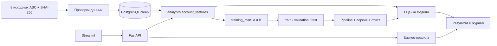

# Данные и архитектура

## Слои

- **Raw:** неизменённые файлы в `data/raw/berka/`; SHA-256 каждого файла в manifest. В `raw.dataset` хранятся режим, дата среза, время импорта, хеши и числа строк. Полные исходные строки сохраняются на диске, а не дублируются миллионом JSON-записей в БД.
- **Clean:** клиенты, счета с владельцами, операции, кредиты. При импорте все восемь исходных таблиц читаются и проверяются. `card`, `order`, `district`, `disp` остаются в raw; используются проверки их ключей/ссылок, владельцы счетов извлекаются из `disp`. Признаки по картам, распоряжениям и полу не используются.
- **Analytics:** SQL-функция признаков с параметром даты; view завершённых кредитов для обучения. Запрос с новой заявкой использует ту же функцию. Условия времени не дублируются в pandas.
- **Application:** правила и модель объединяются в сервисе, результат сохраняется отдельной JSON-записью с версиями. Интерфейс обращается только к API.

## Словарь основных полей

| Сущность / поле | Значение |
|---|---|
| clients.client_id | Анонимный ID клиента; ФИО нет |
| accounts.client_id | Владелец счёта из `disp.type=OWNER`; уполномоченные лица не становятся владельцами |
| accounts.opened_at | Дата открытия счёта |
| transactions.booked_at | Дата операции; времени внутри дня нет |
| transactions.balance | Баланс **после** операции |
| transactions.direction | PRIJEM → credit, VYDAJ/VYBER → debit |
| transactions.category | Исходный k_symbol; UROK — начисленные проценты |
| loans.amount | Историческая сумма кредита при выдаче, не текущий остаток |
| loans.payment | Исторический договорной платёж из исходного набора |
| loans.months | Срок договора, месяцы |
| loans.status | A: завершён без проблем; B: завершён с невыплаченной задолженностью; C: действует, без проблем на момент наблюдения; D: действует, клиент имеет задолженность |
| raw.dataset.reference_date | Максимальная дата операции + 1 день; исключительная верхняя граница наблюдаемых операций |
| applications.request / result | Входные параметры и полный результат на момент проверки |

Денежная единица проекта — исторические чешские кроны, CZK. Конвертации в рубли нет. Даты исходных файлов YYMMDD явно переводятся в 19YY-MM-DD. Возраст/пол из `birth_number` не используются: это не требуется текущей модели и избавляет её от ненужного чувствительного признака.

## Временные признаки

На дату оценки **t** используются операции из `[t − 90 дней, t)`. Операции самого дня t исключены: неизвестно, были ли они до выдачи. Для исторического кредита t — его `issued_at`.

| Признак | Расчёт |
|---|---|
| account_age_days | t минус дата открытия |
| amount, months, payment | Условия договора/заявки, известные в момент оценки |
| tx_count_90d | Количество операций в окне |
| mean_balance_90d | Средний баланс после операций; взвешивание по операциям, не по дням |
| min_balance_90d | Минимальный баланс в окне |
| negative_share_90d | Доля операций с отрицательным последующим балансом |
| monthly_inflow_90d | Сумма входящих операций без UROK / 3 |
| payment_to_inflow | Договорной платёж / monthly_inflow_90d, NULL при нуле |

Поступления — приблизительный показатель денежного потока: в них могут быть переводы, это не подтверждённая зарплата. Счёт моложе 90 дней или без операций получает правило «нужна ручная проверка». Отсутствующие числовые признаки модель заполняет медианами **train**.

## Контроль качества

Проверяются первичные ключи, единственность владельца, внешние ссылки, отсутствие обязательных пропусков, известные статусы, конечные суммы/балансы, положительные параметры кредитов и отсутствие операций/кредитов до открытия счёта. Пустая категория операции разрешена. Отрицательный баланс допустим и содержателен.

Загрузка использует PostgreSQL COPY внутри одной транзакции. Ошибка откатывает всю загрузку. Advisory lock предотвращает конкурирующую инициализацию. Существующий набор не заменяется. Индекс `(account_id, booked_at)` обслуживает выборки исторических окон.

## API

| Метод и путь | Результат |
|---|---|
| GET /health, /metadata | Доступность БД, режим, дата среза |
| GET /clients?q=… | Поиск владельцев, limit/offset |
| GET /clients/{id} | Карточка, счета, кредиты, последние 100 операций |
| GET /loans | Кредиты с фильтром статуса |
| GET /portfolio, /portfolio/export | Срез портфеля, CSV с указанием режима |
| POST /calculator/payment | Аннуитетный платёж |
| POST /applications/evaluate | Проверка и сохранение заявки |
| GET /applications, /applications/{uuid} | Журнал и сохранённый отчёт |

Полная входная схема и примеры полей — в `/docs`. SQL параметризован. Приложение предназначено для одного локального пользователя; аутентификация, разграничение доступа, аудит чтений и защита публичного сервиса в этот объём не входят.
